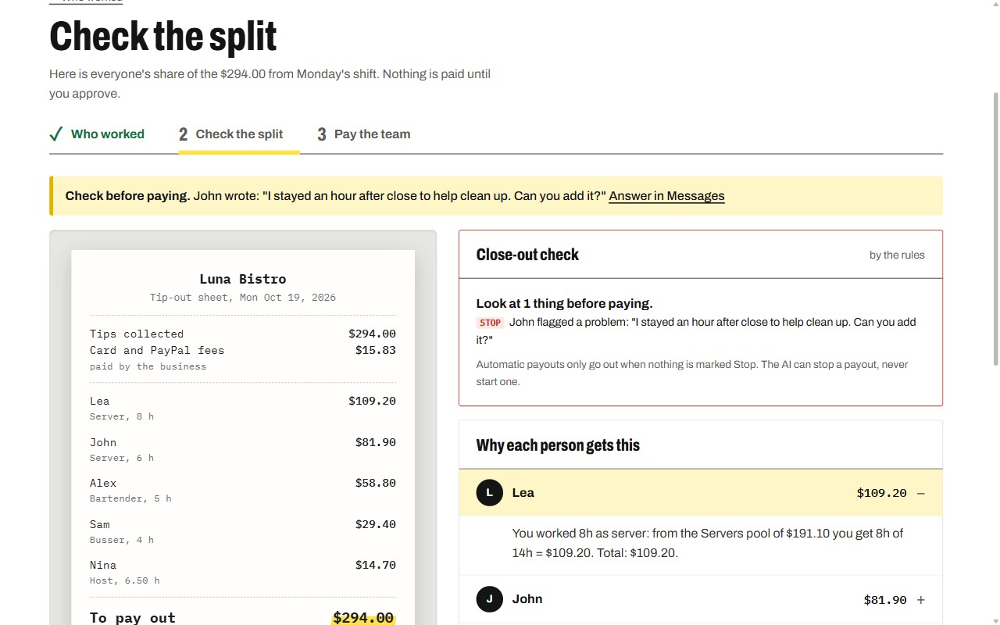
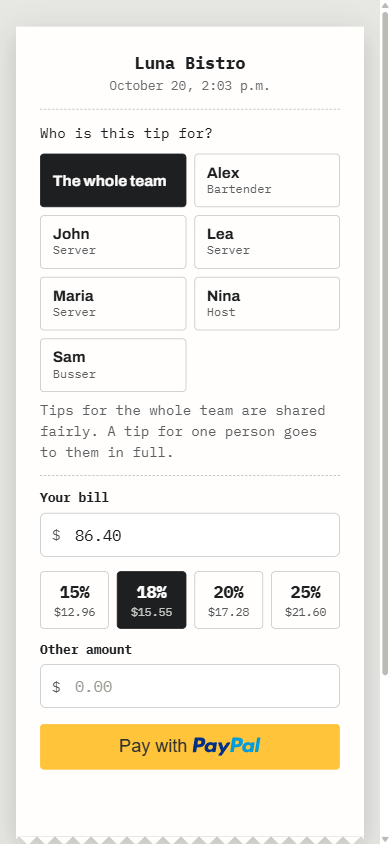
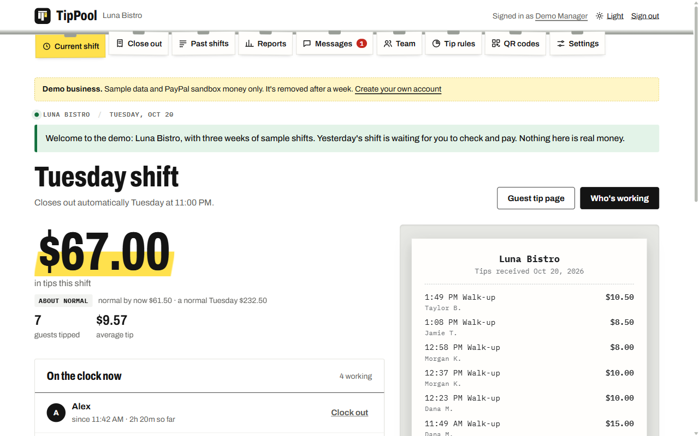
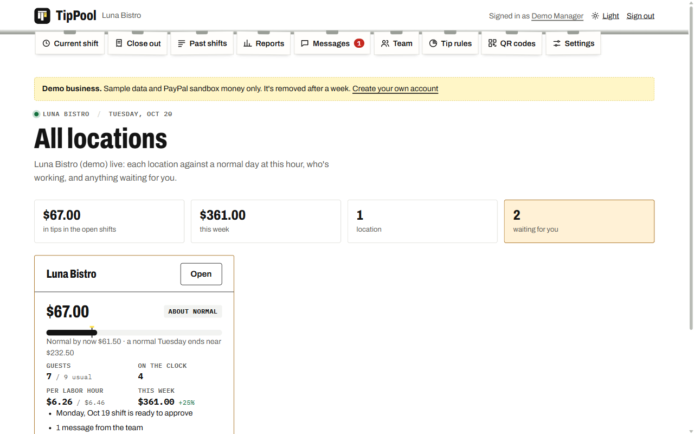
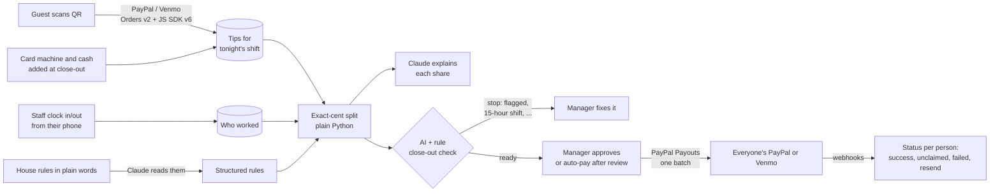

# TipPool

**AI tip pooling, paid out with PayPal: for restaurants, cafés, bars, salons, hotels and any team that shares tips.**

Guests tip with PayPal or Venmo from a QR code. At closing time AI turns the house rules (written in plain
words) into an exact, fair split, explains every person's share and checks the shift. Then one click pays
the whole team with **PayPal Payouts**.

Built for the PayPal AI Hackathon 2026 ("Build What's Next with PayPal and AI").

> **Live demo: https://tippool-if7m.onrender.com** · click **Try the demo** on the sign-in page: no sign-up, sandbox
> money only. (Free hosting: the first visit after a quiet spell can take up to a minute to wake up.)

| Closing a shift: every share explained, checked, then paid | The guest's tip page (from the QR code) |
|---|---|
|  |  |

| Current shift | Live board: every location against a normal day |
|---|---|
|  |  |

---

## For judges: the 2-minute path

**Try the demo** opens *Luna Bistro*, a sample restaurant with three weeks of history. The **Demo tour**
card in the corner ticks off each step as you go:

1. **Check yesterday's split.** Every share is in exact cents, with a plain-English explanation per person
   and an AI close-out check that looked for anything odd before money moves.
2. **Answer the team.** John flagged his hours from his phone. A flagged shift is never paid automatically.
3. **Pay everyone in one click.** One PayPal Payouts batch pays the whole team. Watch each payout turn
   `SUCCESS` (real sandbox payouts).
4. **Tip as a guest.** The page the QR code opens, with PayPal and Venmo buttons. It's in 7 languages, and
   PayPal's own window follows the guest's language too. Demo tip pages show a sandbox buyer login to pay with.
5. **Ask about your tips**, e.g. *"Who earned the most last week?"* Claude answers from your numbers, and
   acts once you confirm: *"Close out tonight, add $40 cash and pay everyone"* is one plan, done in order.
6. **Change the rules in plain words.** AI reads them into structured rules and warns about anything that
   breaks tip law (e.g. managers taking from the pool, which the US FLSA doesn't allow).

### Testing notes for judges
- No sign-up and no credentials are needed: **Try the demo** signs you in to a fresh sample business.
- Everything runs on the **PayPal sandbox** (test money). Demo tip pages show a sandbox buyer login to pay
  a test tip with; demo payouts go to sandbox accounts.
- To run it yourself instead, see [Run it locally](#run-it-locally-sandbox): it works without any keys
  (the demo uses a built-in AI fallback), and with your own sandbox keys for real PayPal calls.
- Hosted on **Render** (blueprint in `render.yaml`) with a Neon Postgres database.

## The problem

Tipped teams split money by hand at the end of every shift: a spreadsheet, a calculator, cash envelopes,
or bank transfers one by one. It's slow, it's error-prone, and the staff can't see how their share was
worked out. Owners with several locations, card and cash tips, and different rules per role have it worst.

## How it works



- **Rules in plain words.** *"Bartenders get 20%, bussers 10% split equally, the rest goes to servers by
  hours."* Claude turns that into structured rules and flags legal problems.
- **Tips in.** One shared QR code per location (print as many as you need: table tents, cards, stickers,
  posters, or 6 per page), or personal codes for businesses where a tip goes to one person. Orders are created
  and captured on the server, so the amount can't be changed in the browser. Tip buttons fit the business:
  % of the bill for restaurants and salons, small amounts for cafés.
- **Card and cash tips too.** The manager adds the card-machine and cash totals at close-out, so the whole
  day's tips are shared, not only the QR ones.
- **Who worked, without typing.** Staff clock in and out from their own private tips page. Each person can
  have a usual week (Mon–Fri 6h). The close-out fills itself in; the manager fixes exceptions.
- **The split.** Plain Python does the money math in exact cents (the AI never decides amounts), so the
  shares always add up to the total. Claude writes a short explanation for every person.
- **Team tips or personal tips.** Pooled (restaurants), personal (salons, delivery), or the guest chooses.
- **Tips out.** One PayPal Payouts batch pays everyone to their PayPal or **Venmo**. Each worker confirms
  their own payout address; changes need a manager's approval. Failed or unclaimed payouts can be reminded,
  taken back and sent again. The PayPal balance is checked first.
- **Automatic close-outs.** Each location sets its closing time per day; the shift closes, splits and (after
  an optional review window) pays by itself, unless the check stops it.

### Built for real businesses
- **Several locations, any kind of business.** Each location has its own roles (presets for restaurant,
  café, bar, salon, hotel, delivery, or your own), rules, codes and closing times. An **All locations**
  overview for owners.
- **Business accounts.** Sign up, invite managers or shift leads (leads can close out, not pay), connect
  **your own PayPal** (the secret is stored encrypted). Each business only ever sees its own data.
- **Money handled honestly.** PayPal's fee is read from every payment: the business covers it, or it comes
  off before the split. Refunds, chargebacks and disputes are tracked. USD, EUR, GBP, CAD, AUD.
- **Live board.** Every location against a normal day at this hour (the same weekday over the last
  8 weeks), tips per labor hour, who's working, and what's waiting. It refreshes itself.
- **Smart alerts.** The owner hears about quiet problems: no guest tips by the usual time (QR codes missing?),
  tips far below normal, someone clocked in 12+ hours, a shift never closed or waiting days, refunds piling up.
- **Owner controls.** A payout approval limit (bigger payouts wait for the owner, even automatic ones), an
  emergency freeze for every payout, managers and shift leads limited to their own locations, and a daily
  or weekly summary email.
- **Reports and history.** Tips per person, role and shift, CSV export for payroll, and a full activity log
  (who did what, filterable, downloadable).
- **Quick setup.** Add a whole team at once (paste a list or a CSV) and email everyone their private link.
  Dark mode for late close-outs.
- **Staff side.** A private link per person (no account needed): their shifts, shares, explanations and
  totals, clock in/out, and "flag a problem". It installs on the home screen like an app.
- **Guests in their language:** English, Español, Français, Deutsch, Italiano, Português, Română.

## PayPal APIs used

| API | Used for |
|---|---|
| Orders API v2 (create, capture, get) | collecting each tip, server-side |
| JS SDK v6 (`paypal-payments`, `venmo-payments`) | PayPal and Venmo buttons on the tip page, in the guest's language |
| Payouts API (batch, status, cancel unclaimed item; PayPal + Venmo recipients) | paying the whole team in one call, fixing payouts that didn't arrive |
| Reporting: balances | checking there's enough PayPal balance before paying |
| Webhooks + signature verification (per business) | `PAYMENT.CAPTURE.COMPLETED/REFUNDED/REVERSED`, `CUSTOMER.DISPUTE.CREATED`, `PAYMENT.PAYOUTS-ITEM.*`, `PAYMENT.PAYOUTSBATCH.*` |
| OAuth 2.0 client credentials | server authentication (token cached) |

**Verified against the real sandbox**: `python manage.py sandbox_check` runs sign-in, the balance check, a
real tip order, a split and a real Payouts batch to five sandbox accounts, then waits for PayPal to finish:

```
OK    PayPal sign-in (OAuth client credentials)  token ok
OK    Balance check (Reporting API)  USD 4996.91
OK    Create a real tip order (Orders v2)  8U5313092A8066220
OK    Split the shift (exact cents) + close-out check  Maria $11.20, John $9.33, Alex $8.00, Lea $7.47, Sam $4.00
OK    Pay the team (Payouts API batch)
OK    PayPal processes the payouts  batch HEMP9YW3826J2: maria… SUCCESS, john… SUCCESS, alex… SUCCESS, lea… SUCCESS, sam… SUCCESS
Shift status: paid.
```

## AI used

**Claude API** (`claude-opus-5-5`, structured outputs), or **Google's Gemini API** (free tier, newest Flash
model, JSON-schema outputs) as a no-cost alternative. The operator picks one in Platform settings; every AI
feature works the same with either, and the free built-in assistant takes over when neither is on. Used for:
- **Reading tip rules** written in plain words, with legal warnings.
- **Reading a photo of the schedule** (vision) to fill in who worked.
- **Explaining each person's share** in one or two sentences.
- **The close-out check** before any payout: rule findings (a 15-hour shift, a forgotten clock-out, an
  unconfirmed address, a flagged problem, a total far from normal) plus Claude's review and suggested fixes.
- **Ask about your tips, an agent that moves money:** answers from the business's own numbers, and does
  things in plain words: *"Close out tonight, add $40 cash and pay everyone"* becomes a 3-step plan (close
  out from clock-ins, split, add the cash, pay through PayPal Payouts) confirmed once and done in order.
  *"Fix the payouts that didn't arrive"* sends failed payouts again to the corrected address and reminds
  people with unclaimed ones. Every step is checked again when it runs (the close-out check, the payout
  freeze, the owner's approval limit), and a plan stops before any money moves if a step can't be done.

**Guardrails.** The AI never decides amounts (exact-cent Python does). It can **stop** a payout but never
start one. Every action it proposes needs the manager's confirmation, through a signed, expiring,
single-use token. Text sent to PayPal is always written by us, never by the AI.

`AI_MODE=mock` runs a free built-in rule parser, template explanations and offline answers to common
questions, so the app works without an API key (and the demo history is generated this way).

## Security and money safety

- Every business is isolated: every query is scoped to the signed-in manager's business, and tests check
  that one business can't reach another's data.
- Each business's PayPal secret is encrypted at rest (Fernet).
- Payouts can't go out twice: one fixed `sender_batch_id` per shift attempt, unclear answers from PayPal
  are checked, never blindly re-sent, and a shift is only marked paid when every payout arrived.
- Webhooks are applied only when PayPal's signature verifies; otherwise the app asks PayPal directly.
- Rate limits on sign-in (failures only), password reset, tip orders and the demo. After 10 wrong passwords
  in a row an account pauses for a minute and its owner gets an alert email. Optional two-step sign-in (TOTP).
- Changing a password needs a 6-character code sent by email (valid 5 minutes); a new password can't be the
  current one, and every change or reset sends a notice.
- Managers and shift leads can be limited to their own locations; leads can close out but never pay.
- Running the site (Platform settings) belongs to the first account on a new site, or needs a one-time setup
  code from the server's log. Platform secrets (email password, API keys) are encrypted and never shown again. Secure cookies, HSTS, CSRF protection, and a referrer policy that keeps private staff links from leaking to other sites.
- CSV exports are protected against spreadsheet formula injection.
- AI use is capped: a daily limit for the whole site (set in Platform settings), a daily share per business
  (smaller for demos) and a per-person limit on Ask, so accounts made just to use the AI can't run up costs
  or use up a free quota. Past a limit, the built-in assistant answers and nothing stops working.

## Tech

Django 5.2 · Python 3.11 · PostgreSQL (production) / SQLite (local) · PayPal REST APIs and JS SDK v6 ·
Anthropic Claude API · plain HTML/CSS/JS (no front-end framework) · 339 tests and a lint check, run on GitHub Actions.

## Run it locally (sandbox)

Requirements: Python 3.11+, a free PayPal Developer account.

```bash
git clone https://github.com/braileanuolimpiu-max/tippool.git && cd tippool
python -m venv .venv
.venv\Scripts\activate          # Windows  (macOS/Linux: source .venv/bin/activate)
pip install -r requirements.txt
copy .env.example .env          # macOS/Linux: cp .env.example .env
```

Copying `.env.example` to `.env` is required on your computer: it turns on development mode
(`DJANGO_DEBUG=1`). Everything else in it is optional and can be set on the website instead (**Platform**
settings, see below). For a quick local start, fill:
- `PAYPAL_CLIENT_ID`, `PAYPAL_CLIENT_SECRET`: developer.paypal.com → Apps & Credentials → **Sandbox**
  (make sure **Payouts** is enabled for the app).
- `MARIA_EMAIL`, `JOHN_EMAIL`, ...: your sandbox **personal** account emails, so demo payouts really arrive.
- optional: `AI_MODE=claude` and `ANTHROPIC_API_KEY`.

```bash
python manage.py migrate
python manage.py runserver
```

Open http://127.0.0.1:8000 and click **Try the demo**, or **Create a business account**.
Emails (invites, password codes and resets, alerts) print in the terminal until you connect an email
service in **Platform → Email**. Locally, the password-change code is also shown on the page.

Check the PayPal side for real: `python manage.py sandbox_check` (add `--wait 300` to also approve a tip
in your browser as a sandbox buyer and have it captured).

## Deploy (free), then set everything up on the website

The repo includes a Render blueprint (`render.yaml`) and `build.sh`. No code or `.env` editing is needed.

1. Create a free Postgres database on [Neon](https://neon.tech) and copy its connection link.
2. On [Render](https://render.com): **New → Blueprint**, pick this repo, and paste the link as `DATABASE_URL`.
   That's the only value you type: Render generates the two secret keys itself.
3. Open the site and **create your account**. The first account on a new site runs it, and gets
   **Platform** at the top. There, with step-by-step help on each part:
   - **Email:** pick **Brevo** (free, 300 a day), add your sender address there and paste an API key, then
     "Send me a test email". Brevo is used through its web API, because Render's free plan blocks email
     ports (SMTP). Gmail, Outlook and other SMTP services work locally or on a paid plan.
   - **AI:** paste a Claude API key and choose the model.
   - **TipPool's PayPal:** two codes from PayPal, for the demo and for businesses not connected yet.
     PayPal's update address (webhook) is registered automatically.
   - **The demo:** a test buyer login and the demo team's test payout emails.
   - **Scheduler:** two free [cron-job.org](https://cron-job.org) jobs with the ready-made addresses: the work
     (automatic close-outs, smart alerts, summaries) every 30 minutes, and a keep-awake ping (`/up/`, which
     never touches the database) every 10 minutes. The free server stays awake while the free database can
     still sleep and stay within its monthly hours. The page shows when it last checked in.
4. Each business connects its own PayPal in **Settings → Payments** (4 plain steps, no technical fields).

`.env` still works for local development (see `.env.example`); anything saved on the website comes first.

## Tests

```bash
python manage.py test tips
```

339 tests cover:
- the split engine (cents always add up, edge cases, legal warnings) and the rule parser
- the full tip → split → payout flow with PayPal mocked, including fees, payouts that fail or go unclaimed,
  refunds and disputes
- the close-out check and Ask actions
- security: business isolation, rate limits, tokens, unsigned webhooks
- the demo, the tour, the guest page languages, and the owner features (alerts, digest, limits, per-location managers)

They run on every push with GitHub Actions, together with `ruff check .`.

## Project layout

```
config/             Django settings and URLs
tips/
  models.py         businesses, locations, staff, shifts, tips, payouts
  split.py          the exact-cent split engine
  ai.py             Claude calls (rules, explanations, checks, Ask) and the offline fallback
  paypal.py         PayPal REST client (Orders, Payouts, balances, webhooks)
  services.py       tip capture, close-out, paying a shift (locks, freeze, approval limit)
  check.py          the close-out check before any payout
  watch.py, digest.py, insights.py   smart alerts, summary emails, "normal by now"
  operator.py, platform.py           Platform settings (stored encrypted, no code needed)
  tests/            the test suite
templates/, static/ plain HTML, CSS and JS
docs/               screenshots and the demo video script
```

## License

MIT, see [LICENSE](LICENSE).
